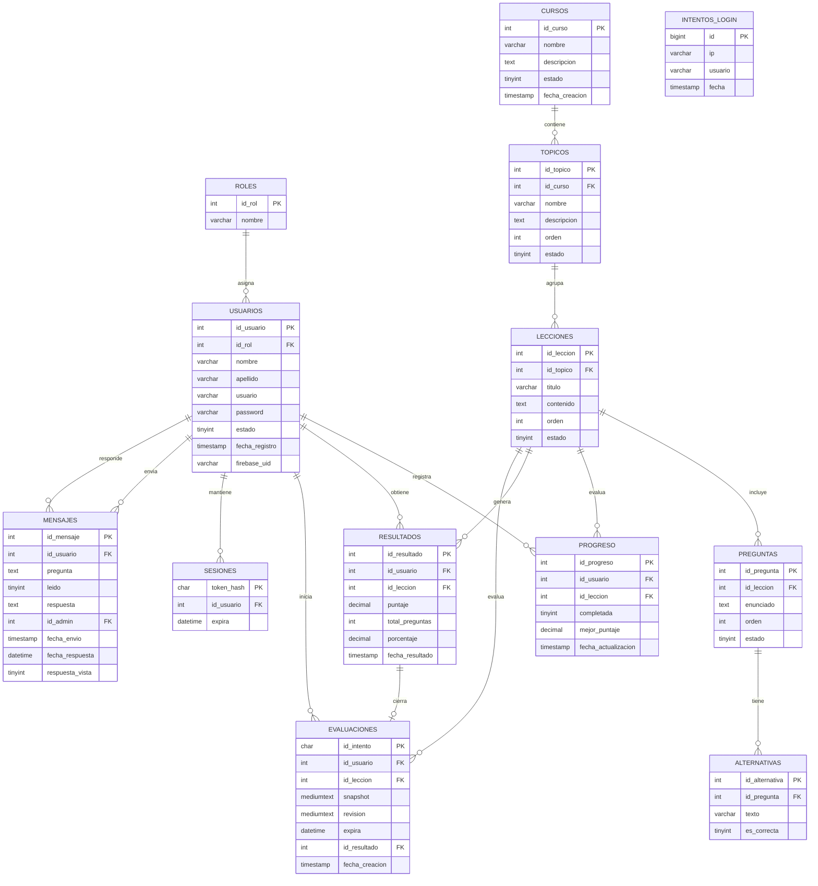
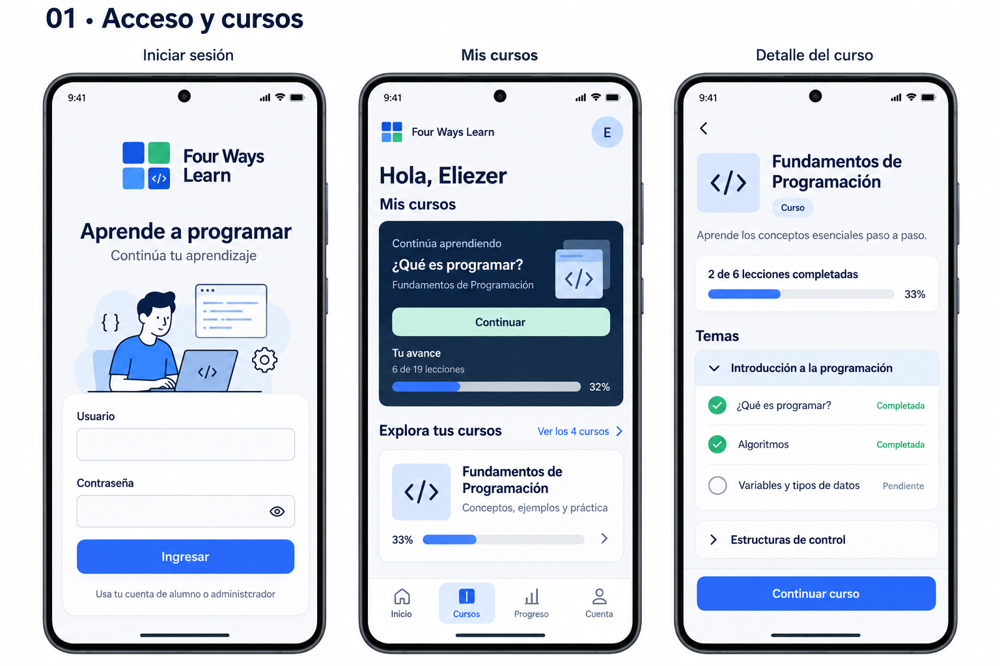
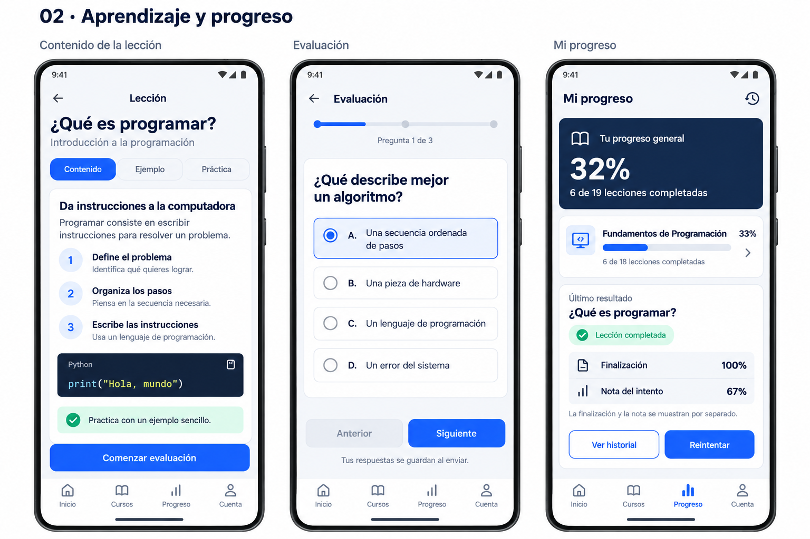
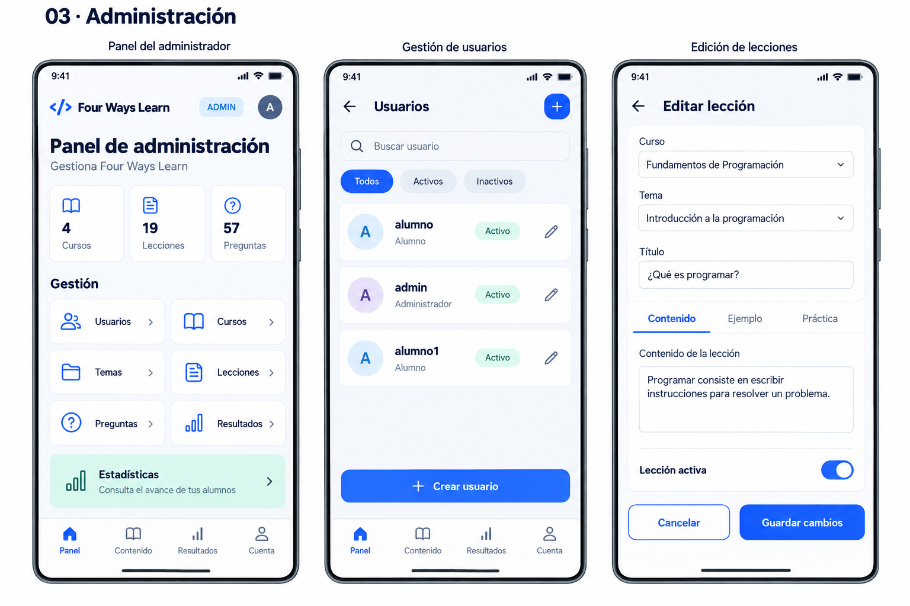

# FOUR WAYS LEARN

Proyecto académico de aprendizaje de programación formado por tres piezas que comparten una misma base de datos:

- **App Android** para alumnos (Kotlin).
- **API REST** en PHP sobre **MariaDB**.
- **Panel web** de administración (HTML, CSS y JavaScript).

El acceso a la app se autentica con **Firebase Authentication**; la API valida el ID token y emite un **token de sesión propio** para el resto de las peticiones.

---

## Funcionalidades

### App Android (alumno)
- Inicio de sesión con correo y contraseña mediante Firebase.
- Catálogo de cursos y temas.
- Lecciones con contenido dividido por secciones.
- Evaluaciones con preguntas y alternativas, y retroalimentación al finalizar.
- Progreso por curso, tema y lección, e historial de resultados.
- Consulta sin conexión de cursos y temas (caché local en SQLite).
- Mensajes al administrador y lectura de sus respuestas.
- Pantalla de cuenta y cierre de sesión.

### App Android (administrador)
- Panel con los módulos del sistema.
- Alta, edición y **baja lógica** de cursos, temas, lecciones, preguntas y usuarios.
- Consulta de resultados y estadísticas.
- Respuesta a los mensajes de los alumnos.

### Panel web
- Las mismas funciones de administración desde el navegador.
- Ingreso con usuario y contraseña de MariaDB.
- **Borrado definitivo** de registros (además de la baja lógica).

---

## Arquitectura

```
                        Firebase Authentication
                                 │
                                 │ ID token
                                 ▼
  App Android (Kotlin) ──► API PHP (four_ways_api) ──► MariaDB (db_fw_learn_v2)
        Retrofit/JSON            ▲                          ▲
                                 │ usuario/contraseña       │
                      Panel web (four_ways_admin) ──────────┘
```

- La app obtiene un **ID token** de Firebase y lo envía a `login_firebase.php`. La API lo valida contra Firebase, localiza al usuario por `firebase_uid` y crea una sesión con un token propio de 64 caracteres hexadecimales.
- El resto de las peticiones viajan con la cabecera `Authorization: Bearer <token>`.
- El panel web entra por `login.php` con las credenciales de MariaDB y recibe el mismo tipo de sesión.

---

## Estructura del repositorio

```
FW_LEARN/          App Android (Gradle). Esta carpeta se abre en Android Studio.
four_ways_api/     API PHP. Se copia a C:\xampp\htdocs\.
four_ways_admin/   Panel web. Se copia a C:\xampp\htdocs\.
database/          Script SQL de la base de datos.
docs/              Capturas e imágenes de la documentación.
```

---

## Tecnologías

| Capa | Tecnologías |
|---|---|
| Android | Kotlin, ViewBinding, RecyclerView, Retrofit + Gson, SQLite, SharedPreferences, Firebase Authentication |
| API | PHP 8, consultas preparadas con mysqli, cURL, Apache |
| Base de datos | MariaDB / MySQL |
| Panel web | HTML, CSS, JavaScript |

---

## Requisitos

- **Android Studio** con **JDK 17** y SDK de Android **API 36.1**.
- **XAMPP** con Apache, MySQL/MariaDB y PHP 8 (extensión `curl` habilitada).
- Un **proyecto de Firebase** con el método **Correo electrónico/contraseña** habilitado.

---

## Puesta en marcha

### 1. Base de datos
1. Abre XAMPP e inicia **Apache** y **MySQL**.
2. Entra a `http://localhost/phpmyadmin/` y crea una base de datos llamada **`db_fw_learn_v2`** con cotejamiento `utf8mb4_general_ci`.
3. Selecciónala e **importa** el archivo `database/db_fw_learn_v2.sql`.
4. Si usas otro usuario o contraseña de MariaDB, ajústalos en `four_ways_api/config/conexion.php`.

### 2. API
1. Copia la carpeta `four_ways_api` a `C:\xampp\htdocs\`.
2. Comprueba que responde en `http://localhost/four_ways_api/api/health.php`.

### 3. Panel web
1. Copia la carpeta `four_ways_admin` a `C:\xampp\htdocs\`.
2. Abre `http://localhost/four_ways_admin/`.
3. `four_ways_admin/js/config.js` apunta a `/four_ways_api/api/`, por lo que ambas carpetas deben quedar dentro de `htdocs`.

### 4. App Android
1. Abre la carpeta `FW_LEARN` (la que contiene `settings.gradle.kts`) en Android Studio.
2. En `gradle.properties`, deja **una sola** línea `FW_API_BASE_URL`:
   ```properties
   # Emulador
   FW_API_BASE_URL=http://10.0.2.2/four_ways_api/api/

   # Celular físico en la misma red (reemplaza por la IPv4 de tu PC)
   FW_API_BASE_URL=http://192.168.1.72/four_ways_api/api/
   ```
   No quites la `/` del final.
3. Confirma que existe `FW_LEARN/app/google-services.json`.
4. Sincroniza Gradle y ejecuta la app. Apache y MySQL deben seguir encendidos.

---

## Cuentas de prueba

| Uso | Correo / usuario | Contraseña |
|---|---|---|
| App Android (Firebase, administrador) | `admin@example.com` | `Admin2026!` |
| App Android (Firebase, alumno) | `alumno@example.com` | `Alumno2026!` |
| Panel web (MariaDB, administrador) | `admin` | `AdminFW2026!` |
| Panel web (MariaDB, alumno) | `alumno` | `AlumnoFW2026!` |

> La app entra por **Firebase**, así que usa el **correo**. El panel web entra por `login.php`, que valida contra la tabla `usuarios` de MariaDB, así que usa el **usuario** y la contraseña de la base.

> Si vuelves a crear las cuentas en Firebase, sus **UID** cambian. Actualiza `usuarios.firebase_uid` con el UID de cada cuenta.

---

## Configuración de Firebase

- **Android:** `FW_LEARN/app/google-services.json` (se descarga de la consola de Firebase).
- **API:** `four_ways_api/config/firebase.php` con `project_id` y `api_key`.
- `login_firebase.php` valida el ID token contra Firebase (`accounts:lookup`), comprueba que la cuenta esté activa y busca al usuario por `firebase_uid`.

Pasos en la consola de Firebase:
1. Crea el proyecto y registra la app Android con el paquete `com.example.four_ways_learn`.
2. Habilita **Authentication → Correo electrónico/contraseña**.
3. Crea las cuentas de prueba.
4. Copia el **UID** de cada cuenta y colócalo en `usuarios.firebase_uid`.

---

## API

Todas las respuestas (excepto `health.php`) siguen este formato:

```json
{ "success": true, "data": {}, "mensaje": "" }
```

| Método | Ruta | Descripción |
|---|---|---|
| POST | `login_firebase.php` | Inicia sesión con el ID token de Firebase (app). |
| POST | `login.php` | Inicia sesión con usuario y contraseña (panel web). |
| GET | `me.php` | Devuelve el usuario de la sesión. |
| POST | `logout.php` | Cierra la sesión. |
| GET | `cursos.php` | Cursos activos. |
| GET | `topicos.php?curso_id=` | Temas de un curso. |
| GET | `lecciones.php?topico_id=` | Lecciones de un tema. |
| GET | `leccion.php?id=` | Lección con su contenido. |
| GET | `avance.php` | Progreso general del alumno. |
| POST | `evaluaciones.php` | Inicia una evaluación. |
| POST | `enviar_evaluacion.php` | Envía las respuestas y obtiene el resultado. |
| GET | `resultados.php` | Historial de resultados del alumno. |
| POST | `mensaje_enviar.php` | Envía una consulta al administrador. |
| GET | `mensajes_alumno.php` | Mensajes y respuestas del alumno. |
| POST | `mensajes_alumno.php` | Marca una respuesta como vista. |
| GET | `mensajes.php` | Bandeja de mensajes (panel web). |
| POST | `mensaje_leer.php`, `mensaje_responder.php` | Marca como leído / responde (panel web). |
| GET/POST/PUT/DELETE | `admin.php?recurso=` | Alta, edición, baja lógica y consulta (`cursos`, `topicos`, `lecciones`, `preguntas`, `usuarios`, `resultados`, `estadisticas`). |
| DELETE | `admin_eliminar.php?recurso=` | Borrado definitivo (panel web). |
| GET | `health.php` | Comprobación de estado del servicio. |

---

## Modelo de datos

### Base de datos (MariaDB)



`INTENTOS_LOGIN` solo registra los intentos de acceso (IP, usuario y fecha); no tiene clave foránea.

### Caché local (Android, SQLite)

| Tabla | Clave primaria | Campos |
|---|---|---|
| `cursos` | (id_usuario, id_curso) | nombre, descripcion, total_lecciones, lecciones_completadas, porcentaje_avance |
| `topicos` | (id_usuario, id_curso, id_topico) | nombre, descripcion, orden, estado, total_lecciones, lecciones_completadas, porcentaje_avance |

La sesión del alumno se guarda en `SharedPreferences` (`fw_session_v2`): el token de la API y los datos del usuario en JSON.

---

## Capturas







---

## Solución de problemas

| Síntoma | Causa probable | Solución |
|---|---|---|
| La app muestra "Error de conexión". | Apache o MySQL apagados, o URL incorrecta. | Enciende XAMPP y revisa `FW_API_BASE_URL`; en celular usa la IPv4 de la PC. |
| La API responde 401 "Inicia sesión nuevamente". | Token vencido o inexistente. | Vuelve a iniciar sesión. |
| 403 "La cuenta no está vinculada a un usuario activo". | `firebase_uid` vacío o distinto. | Copia el UID de Firebase en `usuarios.firebase_uid`. |
| Firebase no inicializa en la app. | Falta el plugin `google-services` o el `google-services.json`. | Aplica el plugin y coloca el archivo en `app/`. |
| El panel web no carga datos. | Carpetas fuera de `htdocs` o `API_URL` incorrecta. | Copia `four_ways_admin` y `four_ways_api` dentro de `htdocs`. |
| "Demasiados intentos. Espera 15 minutos." | Más de 20 intentos de acceso fallidos. | Espera 15 minutos. |

---

## Notas de seguridad

- `four_ways_api/config/conexion.php` y `app/google-services.json` contienen configuración local; no uses las credenciales de ejemplo en producción.
- La `api_key` de Firebase no es secreta, pero conviene restringir su uso desde la consola.
- La app solo permite HTTP para desarrollo (manifiesto de `debug`). En producción sirve la API por HTTPS.
- Cambia las contraseñas de ejemplo antes de publicar.

---

Proyecto académico **Four Ways Learn**.
